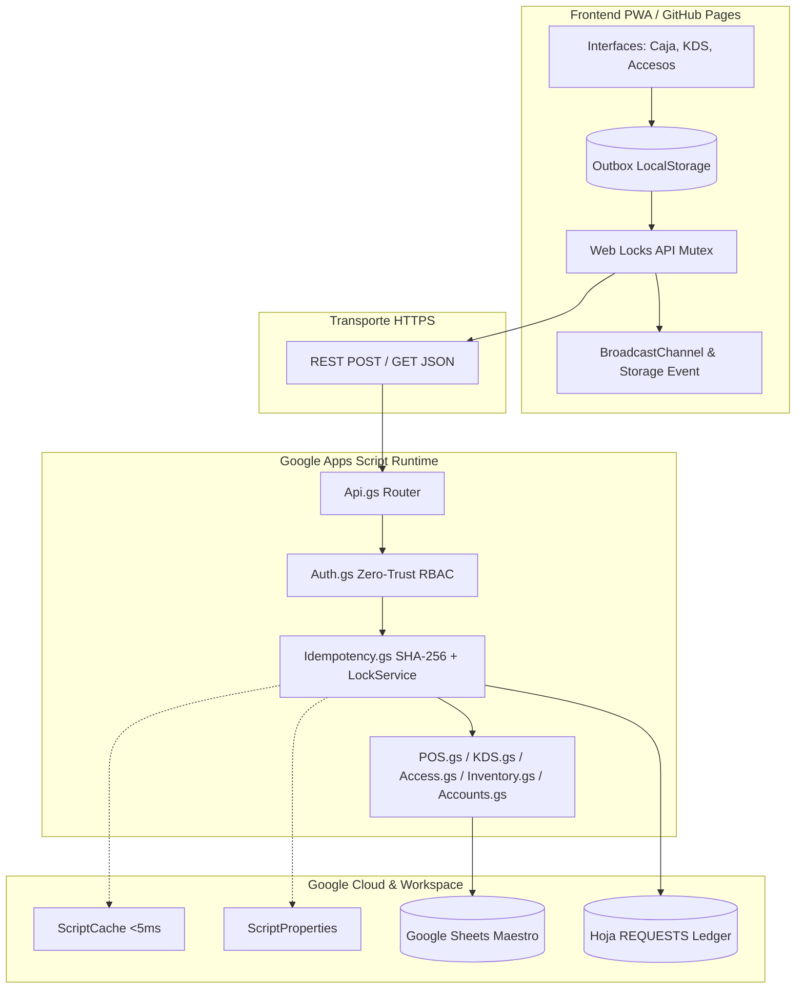
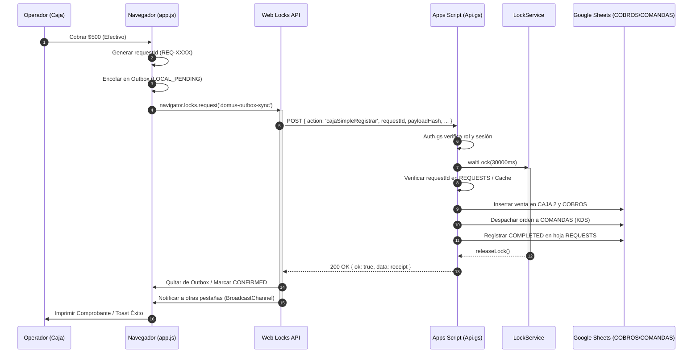

# 🏗️ DOMUS OS · TECHNICAL ARCHITECTURE

Documentación técnica de componentes, arquitectura en capas, flujo de datos y modelo de concurrencia.

---

## 📐 Diagrama de Arquitectura

---

## 🔄 Flujo Transaccional de una Venta (Caja ➔ KDS ➔ Sheets)

---

## 🛡️ Capas de Resiliencia
1. **Pérdida de Red:** Las órdenes quedan encoladas localmente en Outbox y no se pierden al cerrar el navegador.
2. **Pestañas Simultáneas:** Web Locks API previene la duplicación de órdenes al reconectar.
3. **Pérdida de ACK:** Si la orden se escribió en Google Sheets pero la respuesta no llegó al navegador, el reintento detecta el `requestId` con el mismo hash en la hoja `REQUESTS` y devuelve el recibo original.
4. **Mutación de Datos:** Si un bug intenta reusar un `requestId` con otro monto, el servidor rechaza con `409 Conflict: IDEMPOTENCY_KEY_REUSED`.
